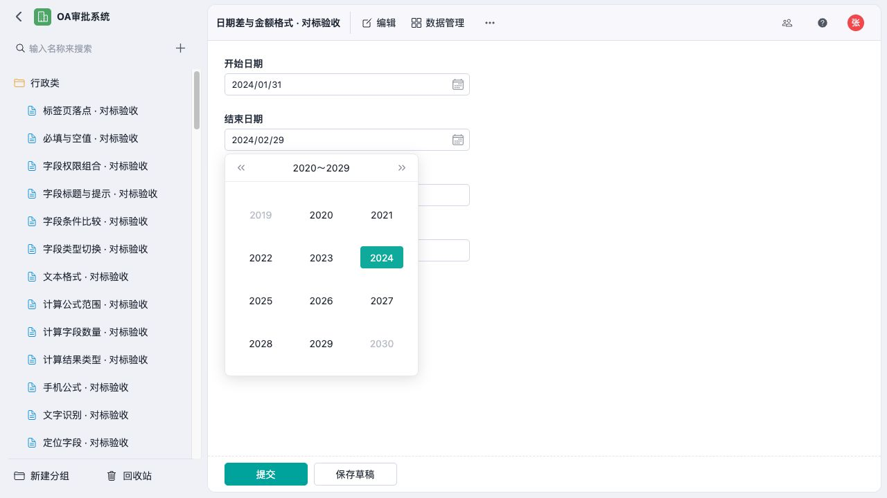

# 日期选择器交互与视觉验收

更新：2026-10-11。沿用唯一[对标计划](docs/jiandaoyun-form-designer-plan.md)的FD04，复用既有日期组件和共用弹层；发布页上一批验收保存在[发布页报告](docs/publication-interaction-visual-qa.md)。

## 本批结论

原日历只有逐月、逐年翻页，缺少参考产品的年月直选；自身全局滚动监听还会因无关区域滚动误关闭。现已补齐年→月→日选择和十年翻页，删除重复监听。导航不提前写值，含时间的字段仍需确认；联动改变当前值或切为只读时取消旧的待选值。

实际主表、子表均已检查。主表年份直选使月份差公式从1重算为49，验后恢复原试填值。子表四种格式经过保存草稿、冷刷新、手机修改、提交、正式记录冷读取，秒数与月份没有截断。星期、动态日期及秒级边界保持生效。手机内层Escape保留明细窗口并返回日期按钮，窗口未溢出。

[390×844手机日期面板](docs/screenshots/jdy-date-calendar-mobile.jpg)与[源站年份选择截图](docs/screenshots/jdy-date-year-reference.jpg)均已实际查看。按源图修正年份面板为280×322，三列四行、62×32选中按钮和十年导航，移除选年状态多余的“今天”。源图1318×1237、本地1280×720，页面、数据和年份状态不同；这不是完整同状态逐像素通过。

## 验证与范围

日期／弹层33项回归通过，包含6项新增交互测试；前端全量1500项／149文件通过。最终视觉调整后再次运行相关测试和完整构建。Sites4项及交付文件另见[机器证据](docs/qa-files/jdy-date-calendar-verification.json)。Vite既有大包提示保留。

后续范围与默认值核对已完成基础属性批次：四种类型与默认来源、公开动态预设／单位、固定／字段范围及开关保留；修复草稿误拒绝并验证发布拦截、修正与旧版保护。见[配置证据](docs/qa-files/jdy-date-settings-verification.json)。该批未改视觉；完整跨来源／公式目录、输出、权限历史、服务端整合及最终交付范围保持未完成。流程未改。
