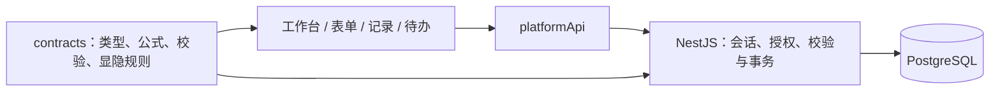

# 平台架构

## 当前业务链路

Vue 3 + TypeScript + Vite 提供中文工作台、表单设计器、记录管理和组织管理；NestJS + PostgreSQL 负责真实会话、业务持久化、授权、版本与事务。`@platform/contracts` 承载共享类型及纯业务规则，不能依赖 DOM 或浏览器存储。

工作台与应用首页统一读取服务端应用。`/login` 是唯一登录入口；未登录访问业务页面时先登录，再返回原地址。已删除路由统一回到工作台，未登录时由路由守卫直接进入登录，不显示停用提示。旧本地标识没有隐式的服务端对应关系，不能拼接为服务端应用或表单 ID。

## 前端职责

- `App.vue` 只承载路由、账号范围的颜色偏好和公共 `AppFeedback`；`stores/notices.ts` 统一短暂通知的去重、数量上限、关闭与定时收起，不初始化本地业务仓库。普通保存、发布、复制等操作复用该入口，不另设常驻成功条；通知浮层独立于弹窗的 inert 区域，弹窗内操作也可读到反馈。
- `stores/platformSession.ts` 与路由守卫处理真实登录态。管理路由就地声明 `requiresAdmin`，表单设计、流程、扩展、发布和组织管理共用守卫检查；服务端仍独立鉴权。头像菜单只展示当前账号、组织管理入口与退出登录。
- `features/workspace/` 提供工作台和服务端应用首页；`features/data/` 提供服务端表单设计与版本发布；`features/collaboration/` 和 `features/processes/` 承载记录及流程协作。
- 应用首页的填写、数据管理与流程视图使用地址中的 `view` 状态；记录状态与历史版本由 `state`、`version` 表达，切换和刷新保持一致。新填写始终使用最新版。记录列表加载期间禁止切换正式记录、草稿与版本，避免旧响应与新标签错位。
- 填写页不预读记录列表。失败重试只重做失败的操作，并保留未保存确认；列表设置保存成功后的刷新失败，不重复保存设置。只有一个可用权限组时直接使用，不展示无意义的选择器。
- `features/forms/` 中的字段画布、属性检查器与运行态控件继续复用。正式填写中的富文本、地址、签名、定位和数字输入复用原控件，保留原交互并接收服务端字段权限。服务端设计器和预览通过 `runtimeDataKey` 注入上下文；组织信息通过 API 获取。
- `stores/pageDesigner.ts` 统一加载、保存与发布表单草稿。切换表单后，旧请求不能覆盖新页面；保存只确认实际提交的快照，请求期间的后续修改仍标记为未保存。发布事务直接返回最新编辑上下文，前端不再追加一次读取，把发布成功误判为刷新失败。
- `features/organization/` 保留部门树、成员列表、角色分组与权限查询。`stores/organization.ts` 独立读取和保存服务端目录。读取空目录不创建示例数据，第一次主动保存才初始化；页面内存状态随真实登录账号切换清空，旧请求结果不能写入新账号状态。
- 角色权限页与成员权限查询统一读取服务端表单权限组；成员必须明确关联登录账号，停用、离职或撤权立即反映到查询结果。原角色授权编辑器、前端授权计算和旧应用目录接口已删除，配置入口直接进入已有表单发布页的访问权限设置。发布页签使用路由 `section`，刷新、后退和未保存保护沿用同一条链路。
- `assets/styles/base.css` 只维护设计变量、基础 Reset 与页面尺寸；共享控件样式在 `components/shared/`；业务样式与对应 feature 放在一起。流程画布自行导入 Vue Flow 和画布样式。

`platformRequest` 是 JSON、上传与下载共同的请求边界，统一解析 `PlatformError`、HTTP 状态、requestId 与安全日志。非 JSON 错误不丢原 HTTP 状态，5xx 不展示内部异常正文。请求层不自动弹窗、跳转或报告成功；调用页面仅展示一次，字段校验、版本冲突与重试入口保留上下文。会话检查只有 401 才清空身份，网络或服务异常保留当前身份和编辑；路由检查失败取消导航，公共提示与工作台重复请求共享的错误会合并。

## 服务端边界

表单草稿与已发布版本分离，记录保留对应版本。保存与权限更新携带当前修订号，冲突时保留输入，不能静默覆盖其他人的修改。`formModel: null` 表示没有独立字段模型，与省略该字段一致；已有字段修改仍须遵守草稿版本及共用字段约束。

表单新建、保存、预览发布影响和发布统一使用 `/pages` 生命周期。旧 `/definitions` 的四个设计写入口及其自动生成默认页面的分支已删除；底层字段模型、版本投影以及记录和权限服务继续复用。启动时历史数据的投影迁移独立保留，不作为运行期的另一条设计链路。

发布页的版本列表读取真实发布快照，展示不可变的发布时间与控件数；历史查看复用原表单预览组件，不改设计草稿。填写链接只供已授权成员登录使用；未发布表单不能分享。二维码和网页嵌入仍未开放，固定二维码图形和未验证的嵌入代码入口已移除，卡片布局保留。

所有记录读写、字段隐藏与只读、子表权限、组织身份和流程操作都由服务端验证；前端隐藏控件不能替代授权。账号与组织成员使用明确的身份映射，不按姓名猜测。

权限组筛选的可用运算符由 Contracts 统一提供，配置界面和服务端校验复用同一规则。数据库筛选与内存授权按相同的空值、选项值和结构化字段语义判断，避免列表可见与记录可操作的结果不一致。

记录搜索在服务端按成员实际可见内容筛选，再统计与分页；不再仅过滤前端当前页。选择项和组织字段按显示名称搜索，富文本只搜索可见正文，不搜索隐藏字段、内部 ID 或 HTML 属性。当前复用授权预览扫描，大数据量性能尚未验收。

页面保存直接返回记录服务在同一页面作用域生成的详情，不重复读取和计算权限。自动流程启动后，有查看权限时重新读取终态权限，因为记录已经进入任务办理阶段；首次提交与幂等重试均返回一致的只读结果。仅有新增权限时沿用不含正文的收据并返回流程编号，不为读取正文而回滚成功的提交，也不额外授予查看权限。

关联查询和写入共用同一记录上下文，审批中的普通成员不能通过关联回填绕过待办权限。页面中的关联回填复用表单校验，失败时字段、关系、审计和幂等命令一起回滚。建立、解除关联直接返回最新记录与关联列表，前端不追加关联读取；关闭详情时仅在记录修订号变化后刷新列表。回填后失去查看权限时沿用普通保存的空收据并退出详情，不扩大读取权限。

归档表单后，应用依据服务端列表更新地址并选择可用表单；恢复后打开恢复的表单。原记录及已发任务保留。这里的回收站管理表单；记录归档目前只有服务端接口，尚无记录回收站与恢复闭环，不能将表单回收站计作记录恢复能力。

权限组只有现行的组配置与合并访问语义。保存时统一归一为 `mode: groups`、`allowMerged: true`，省略旧参数不会跳过启用校验；已从当前版本移除的范围字段必须修正后才能启用，失败不修改配置或审计。

请求日志记录 requestId、路由模板、actorId、状态和耗时，避免输出凭据、Cookie 和敏感业务值。HTTP 异常和后台流程刷新共用脱敏诊断，只保留异常类别、SQLSTATE 和调用位置；单个流程刷新失败会记录定位信息并继续处理其他流程。事务测试覆盖权限拒绝、版本冲突以及失败回滚。具体接口见 [backend-contracts.md](backend-contracts.md)。

## 表单与流程的一条执行链路

`features/workflow/WorkflowView.vue` 保留原简道云式点阵画布、紧凑节点、拖拽添加、撤销重做、预览与属性面板，直接编辑服务端 `ProcessTemplateSpec`。`WorkflowNode` 继续负责节点呈现，`PropertyPanel` 和 `FieldPermissionEditor` 直接配置真实负责人、节点规则和字段权限。节点之间的连线来自任务依赖，起止连线使用明确保存的 startTaskIds/endTaskIds，不再根据首尾任务自动生成。新增、粘贴和删除节点均不补线；右键菜单中的属性、复制、剪切、粘贴和删除复用同一组画布操作与撤销历史。发布时前后端共同检查所有节点是否位于发起至结束的路径上。任务位置与起止节点布局随模板保存。旧 `useWorkflow` 浏览器存储和重复的 `ProcessTemplateEditor` 已删除，不再有单独的本地流程保存。未接入执行的子流程、插件等入口明确不可用，不能将旧模拟行为计入执行能力。

表单通过 `process_templates.start_page_id` 唯一关联一个流程。管理员保存草稿、发布不可变版本或停用；普通成员沿用表单新增权限发起。工作台的“发起流程”打开对应表单，正式提交在同一事务内保存记录、展开处理人、生成任务及轨迹；保存草稿不发起流程。失败整体回滚，重试不会重复生成待办，也不会因为流程后来启用而补发旧提交。

流程保留一份设计草稿和多个已发布版本。`latest_version` 只用于分配递增版本号，`active_version` 决定新流程使用哪个版本；重新启用旧版不会修改已有实例。版本菜单可以只读查看历史，复制历史内容到设计草稿，或管理启用与删除；被流程实例引用或正在启用的版本不能删除。所有版本写操作校验修订号、管理员身份及当前配置兼容性。

流程设计入口默认读取现有设计草稿，节点、连线与属性可直接编辑；打开页面不会写入或发布版本，发布成功后继续留在设计稿。主动查看已发布版本才进入只读，工具栏的“编辑此版本”将其复制到设计稿。版本菜单始终保留返回设计稿的入口。

初次打开、切换版本、复制历史与删除后返回草稿共用画布载入逻辑；读取失败保留当前输入。重新读取复用未保存确认，新建草稿仅在覆盖已有修改时询问。历史只读限制节点编辑，不妨碍管理员停用流程。历史引用已归档表单时仍显示原名称，可复制为草稿后修正，发布与启用才检查能否执行。

切换节点办理表单时，先加载目标表单，再一次性更新节点与数据绑定。加载期间不能保存、切换版本或离开；失败保留原配置。保存成功只确认实际提交的快照，避免把异步产生的新修改误标为已保存。

任务字段权限与子表行范围只能收紧成员的表单权限。表单自动流程运行期间，普通成员从待办办理，常规记录入口只读；底层记录提交接口不能绕开自动流程。流程详情默认展示正文：本人待办按节点权限填写，发起人按现有表单权限查看只读申请单；已办、抄送和委托后的查看沿用各自的节点权限。

抄送节点在前置任务及条件满足后自动送达，只读。待办委托仅转交一项当前可办理的任务，候选人必须已有记录编辑权限，并能补齐任务尚未填写的必填项；已填妥的只读审批仍允许接收。候选查询与委托提交共用现有 `TaskContextService` 校验，与任务完成约束就近维护。转交后原处理人保留进度轨迹，失去该任务办理权。委托不产生新的授权，不提供按日期自动代办。部门/角色仍按已有规则逐人展开，需要全部办理完成后汇合。

工作台栏目与打开的申请由路由中的 `tab`、`process` 标识；刷新、浏览器返回及登录后回跳沿用同一位置，不另存一份列表/详情状态。发起流程列表分别处理各应用的读取结果，一项失败仍保留其他可用入口。首次会话读取失败使用现有页面错误区重试，已有内容保留。

流程详情复用 `RecordEditor` 内嵌展示申请内容，侧栏呈现当前处理人和实际处理记录，不再先展示任务表并嵌套记录弹窗。提交办理先调用同一编辑器保存，成功后才完成任务；保存失败保留输入。完成、刷新或切换节点仍以服务端返回的正文与权限重建编辑器。关闭、刷新和切换节点共用未保存确认，上传和请求期间不可离开。

`GET /processes/:id/record` 统一决定当前身份看到的正文，不由前端猜首个节点。新实例在现有运行定义中记录提交页面及版本；旧实例只有在原页面版本唯一对应时恢复，否则按记录自身结构只读展示。正文撤权或原页不可读取不影响单独查看流程进度。只读正文中的关联区继续允许查看，禁止建、解关联；没有配置关系时不显示空区。

组织与发布设置的离开确认复用 `useDraftDismiss.confirmLeave`。表单设计与提交设置按服务端草稿的 dirty 状态拦截路由离开及同一路由参数变化；无修改直接离开，有修改才询问。

## 提交提示

扩展页的提交提示直接修改 `usePageDesignerStore.state.schema.settings`，通过现有页面保存与发布接口持久化。成功文案、展示方式、继续填写按钮随表单版本发布，不另存本地配置。

新填写和草稿正式提交成功后，填写页复用 `SubmissionReceipt` 显示本次已发布版本的提示，冻结原内容并移除提交入口，不额外弹出重复成功通知。普通草稿与流程草稿都遵守成功文案、展示方式和继续填写设置。点击继续填写时重新读取表单、默认值和收集状态，再创建新的填写组件。只允许新增而无查看权限时，服务端返回不含数据的收据，界面仍使用提交前取得的提示配置。新填写保存草稿后进入现有草稿箱；成功发起流程时，回执提供“查看申请”，进入工作台已有流程详情。草稿成功回执关闭后刷新草稿箱，继续填写走原填写入口；普通记录提交仍进入正式记录。只读流程记录也使用同一申请入口。草稿保存、已有记录编辑和任务办理使用公共短暂反馈。

正式填写复用已发布设置中的提交、草稿按钮文字与显示开关。它们只控制新填和草稿的入口；已提交记录与流程任务仍按服务端编辑权限保存，不能用表单按钮开关替代收集规则或授权。

本次填写中新上传的附件由填写容器统一跟踪。替换、移除或放弃填写时回收未绑定文件；字段显隐和标签页切换不会删除附件。服务端只允许上传者回收未绑定文件，已经进入正式记录或服务端草稿的附件会保留。预览关闭也回收本次上传；浏览器强退和离线后的定时回收尚未实现。

富文本图片通过正文中的 `data-file-id` 接入同一附件事务与下载权限，不能通过移动图片引用绕过原字段权限。上传期间填写容器等待完成后再提交；富文本长度规则由 Contracts 提供，不套用普通文本的默认长度限制。

`FormRuntime.vue` 只承担 `FormPreview` 内的字段交互与模拟校验，不再接受正式记录保存回调、编辑记录参数或本地草稿恢复配置。正式填写统一使用服务端 `RecordEditor`；旧恢复适配器、填写缓存和无人调用的自定义按钮组件已删除。

## 组织目录与编辑

组织管理不再读写本地业务快照，也不使用浏览器保存的迁移命名空间。目录身份由 API 返回；账号关联前重新读取成员，并由服务端在事务中再次核对身份和修订号。没有明确关联时，不把任意成员当作当前登录账号。

组织保存复用服务端的差异合并和幂等命令。同一对象冲突时读取最新已提交数据，并保留弹窗中的修改；未确认成功的命令按原 requestId 重试。角色授权应用列表只来自服务端，已有迁移来源标识仅用于对应服务端已知的历史授权。

组织变更函数只校验待提交候选数据，已删除旧本地保存回调和体验成员切换分支。编辑器直接读取本次操作错误，不根据全局通知 ID 推断保存结果。关闭、路由离开及同路由参数变化统一复用 `useDraftDismiss`，不再另存跳转目标并二次导航；权限组与收集设置也使用同一离开保护。

字段级编辑上下文比较位于 `@platform/contracts`；组织草稿校验只处理未保存输入，不再接收整个 WorkspaceData。暂存键同时包含真实账号和目录身份，不跨账号恢复。浏览器业务存储不可用不影响目录读取与显式保存。

## 未开放扩展与预览边界

自动化、推送、打印等未开放扩展保留原界面和默认配置预览，字段来自当前服务端表单草稿。入口与展示组件使用 `useRuntimeData`，不再初始化 `stores/workspace.ts` 或读取浏览器业务仓库；关闭的配置编辑器不提前挂载。旧保存、执行、归档、启停、重试及插件自动连线处理已从这个入口删除。提交提示仍直接保存服务端草稿。

`useRuntimeData` 缺少注入时只返回空数据。7 个扩展编辑器继续保留原界面、字段配置和纯试算，已移除旧仓库依赖、配置本地保存和试算日志落地。推送密钥生成与连接模拟也已移除，未接通的保存、密钥和连接按钮保持禁用；PluginEditor 保留已有的显式保存回调。

旧 `stores/workspace.ts`、浏览器业务仓库、保存锁、冲突恢复、事务快照及其各类写入 action 已物理删除；仅用于本地工作区的表单复制、填写会话和关系示例也已删除。旧前端授权写入校验随该链路退役。仍被组织管理使用的纯变更函数，以及被表单预览、导入转换和前端事件使用的纯函数与类型保留；它们不保存或授予服务端业务权限。

无人调用的旧字段检查器、旧记录管理组件、PDF 导出分支及其专属字体和主题图片已删除；活跃预览组件保留。后续只对业务明确、能复用现有服务端能力完成闭环的扩展逐项接入，接入时删除该功能的本地执行链路，不做双向同步。

## 验证

- `npm run build`：Contracts、前端、静态托管输出与后端构建。后端先清空 `backend/dist`，避免删除源码后仍执行旧编译产物。
- `npm test`：前端业务测试与真实 PostgreSQL 集成测试；后端测试使用隔离 schema。
- `npm run test:sites`：静态资源打包及路由检查。

核心保障集中在共享规则计算、服务端权限及回滚、表单保存发布与记录操作。浏览器验收补充检查真实布局和交互，不以历史截图代替当前结果。

后端授权测试统一使用现行 `permission-groups` 契约，已删除直授/组模式切换和旧创建人部门追随语义的用例，流程 fixture 明确给出起止连线。现有前端历史测试仍需按实际运行上下文核验；不能为兼容旧测试恢复已删除的生产实现，也不能将未执行或失败的检查计为通过。

2026-10-14 本轮直接验收（未新增测试文件）：

- Contracts、前后端构建及静态托管输出准备通过；浏览器检查发布历史、历史预览、应用视图刷新与扩展页，控制台未见新增警告或错误。
- 隔离数据库的 24 个版本接口请求验证真实时间、控件数、草稿隔离与权限；另 40 个业务请求验证管理员配置、成员草稿恢复与提交、自动发起幂等、审批字段掩码、越权混合写入回滚、必填阻止办结和合法完成。发布 V2 后旧记录、任务页面与流程仍使用 V1。两轮另有 6 次真实登录，隔离 schema 均已清除。
- 内存挂载检查覆盖版本列表和预览的失败恢复、未发布链接禁用、视图路由保留与加载时状态保护；遍历 10 个未开放扩展分区，旧工作区仓库未实例化，旧业务存储读取为 0。

同日架构收敛复核：

- 物理删除 19 个旧实现文件，生产源码与现有测试均无旧仓库、写锁及工作区同步引用；删除依赖旧持久化的测试与全局锁脚手架，保留仍有效的纯规则和组件检查。测试 worker 显式禁用 Node Web Storage，DOM 环境使用 jsdom 自身存储，避免宿主实现污染组件验证。
- 权限配置归一与历史字段启用校验通过 28 个隔离 HTTP 请求；发布结果与编辑状态一致性、过期重试和普通成员写入限制通过 8 个请求，两轮另有 6 次登录，临时 schema 均清除。
- 7 个管理路由分别使用管理员和普通成员完成 14 次内存路由验证。发布状态直接接受事务响应，没有第二次 GET。7 个扩展编辑器真实挂载、切换步骤与纯试算通过，旧存储调用、网络请求及 workspace 实例均为 0，注入数据未改变。
- 整项目构建通过；流程视口仅在画布挂载后定位，删除数据载入时的重复初始化调用。该修复后的前端构建通过，浏览器复核扩展页与原流程画布，布局和编辑入口保留，流程页控制台无警告或错误。
- 12 份现有前端检查共 144 项通过，覆盖发布状态、登录及路由、权限组、取数与关联、前端事件、子表行权限、组织和成员导入；修正旧 fixture 与路由模拟，没有新增测试文件。本轮未运行全量历史测试。

同日业务闭环及再次收敛：

- 浏览器在隔离环境使用原设计器创建采购表单和流程，验证拖入、手动连线、节点移动、右键删除、撤销及刷新恢复；按录入人、核对人两个真实账号完成草稿续填、提交、必填阻止办结、核对、办结和发起人查看结果。原工作台导航、表单树、画布与属性面板保持不变。
- 删除页面保存后的重复详情回读，将委托字段判断移入既有任务上下文。最终 94 次隔离 HTTP 请求覆盖完整审批与抄送、委托权限、越权回滚、幂等和保存后失去访问权限的脱敏回执；故障注入的预期 500 与权限拒绝均按断言验证。
- 删除组织变更中的本地保存回调、体验成员分支及重复离开导航；删除 7 个扩展编辑器无效的暂存键传递。现有组织与恢复检查 19 项通过，直接组件验证同路由切换、未保存确认、忙碌保护、冲突保留及历史版本选择。
- 搜索以 27 条隔离记录验证跨页匹配、总数、字段脱敏及显示值；浏览器验证搜索和清空。草稿保存进入现有草稿箱，刷新后续填提交进入正式记录。构建及差异检查通过，没有新增测试文件。验收服务已停止，临时 schema 已删除；未进行大数据量性能验收或全量历史测试。

同日流程详情与公共边界收敛：

- 以“打开申请—填写办理—提交—发起人查看结果”验收，复用现有表单和子表控件。浏览器使用录入人、核对人真实账号验证直接显示正文、未保存关闭确认、独立保存刷新记录、缺必填阻止办结、自动保存后办结、待办移除和最终只读内容；测试数据位于独立 schema。
- 46 次隔离 HTTP 请求验证流程正文、节点脱敏、委托后只读、抄送、撤权拒绝、固定原页面版本与旧实例回退。进度可见不等于正文可见，正文不可读时保留进度。
- 附件首次绑定按文件 ID 有序加锁，并在锁后重新查询绑定。24 次隔离 HTTP 请求验证竞态只允许一个记录绑定、反序多文件无死锁、失败事务回滚和原记录幂等重试。
- 1000 条隔离记录的身份显示与搜索验证，重复历史身份查询由逐行改为本次查询内批量去重；搜索 SQL 从 1019 次降到 20 次，三次中位耗时从 546.1ms 降到 76.2ms。隐藏字段和子表列不参与命中；不是生产并发性能结论。
- 记录编辑和关联配置统一路由离开/参数切换确认，删除手动二次跳转。权限组选项改为无共享状态副作用的读取，仅当前页面、当前账号仍有效时设置默认组，旧请求不覆盖新账号选择。真实组件挂载验证迟到响应、上传保护、冲突保留和只读关联操作。
- 本轮无新增测试文件；完成整项目构建与差异检查，后续小改补做前端构建。最终数据库核对金额、审批意见、办结与抄送状态一致，隔离环境两进程已停止、schema 已删除。全量历史测试及生产规模并发未覆盖。
