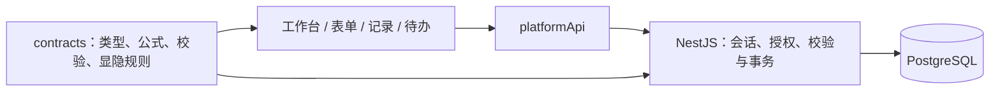

# 平台架构

## 当前业务链路

Vue 3 + TypeScript + Vite 提供中文工作台、表单设计器、记录管理和组织管理；NestJS + PostgreSQL 负责真实会话、业务持久化、授权、版本与事务。`@platform/contracts` 承载共享类型及纯业务规则，不能依赖 DOM 或浏览器存储。

工作台与应用首页统一读取服务端应用。`/collaboration` 跳转到 `/applications`；旧 `/apps/*` 和支付管理地址返回工作台并说明入口已停用。旧本地标识没有隐式的服务端对应关系，不能拼接为服务端应用或表单 ID。

## 前端职责

- `App.vue` 只承载路由、账号范围的颜色偏好和全局提示；`stores/notices.ts` 管理短暂通知，不初始化本地业务仓库。
- `stores/platformSession.ts` 与路由守卫处理真实登录态。头像菜单只展示当前账号、组织管理入口与退出登录。
- `features/workspace/` 提供工作台和服务端应用首页；`features/data/` 提供服务端表单设计与版本发布；`features/collaboration/` 和 `features/processes/` 承载记录及流程协作。
- `features/forms/` 中的字段画布、属性检查器与运行态控件继续复用。服务端设计器和预览通过 `runtimeDataKey` 注入上下文，字段组件优先读取该上下文；组织信息通过 API 获取。
- `stores/pageDesigner.ts` 统一加载、保存与发布表单草稿。切换表单后，旧请求不能覆盖新页面；保存只确认实际提交的快照，请求期间的后续修改仍标记为未保存。
- `features/organization/` 保留部门树、成员列表、角色分组与权限查询。`stores/organization.ts` 独立读取和保存服务端目录。读取空目录不创建示例数据，第一次主动保存才初始化；页面内存状态随真实登录账号切换清空，旧请求结果不能写入新账号状态。
- `assets/styles/base.css` 只维护设计变量、基础 Reset 与页面尺寸；共享控件样式在 `components/shared/`；业务样式与对应 feature 放在一起。流程画布自行导入 Vue Flow 和画布样式。

## 服务端边界

表单草稿与已发布版本分离，记录保留对应版本。保存与权限更新携带当前修订号，冲突时保留输入，不能静默覆盖其他人的修改。`formModel: null` 表示没有独立字段模型，与省略该字段一致；已有字段修改仍须遵守草稿版本及共用字段约束。

所有记录读写、字段隐藏与只读、子表权限、组织身份和流程操作都由服务端验证；前端隐藏控件不能替代授权。账号与组织成员使用明确的身份映射，不按姓名猜测。

请求日志记录 requestId、路由模板、actorId、状态和耗时，避免输出凭据、Cookie 和敏感业务值。事务测试覆盖权限拒绝、版本冲突以及失败回滚。具体接口见 [backend-contracts.md](backend-contracts.md)。

## 表单与流程的一条执行链路

`features/workflow/WorkflowView.vue` 保留原简道云式点阵画布、紧凑节点、拖拽添加、撤销重做、预览与属性面板，直接编辑服务端 `ProcessTemplateSpec`。`WorkflowNode` 继续负责节点呈现，`PropertyPanel` 和 `FieldPermissionEditor` 直接配置真实负责人、节点规则和字段权限。节点之间的连线来自任务依赖，起止连线使用明确保存的 startTaskIds/endTaskIds，不再根据首尾任务自动生成。新增、粘贴和删除节点均不补线；右键菜单中的属性、复制、剪切、粘贴和删除复用同一组画布操作与撤销历史。发布时前后端共同检查所有节点是否位于发起至结束的路径上。任务位置与起止节点布局随模板保存。旧 `useWorkflow` 浏览器存储和重复的 `ProcessTemplateEditor` 已删除，不再有单独的本地流程保存。未接入执行的子流程、插件等入口明确不可用，不能将旧模拟行为计入执行能力。

表单通过 `process_templates.start_page_id` 唯一关联一个流程。管理员保存草稿、发布不可变版本或停用；普通成员沿用表单新增权限发起。工作台的“发起流程”打开对应表单，正式提交在同一事务内保存记录、展开处理人、生成任务及轨迹；保存草稿不发起流程。失败整体回滚，重试不会重复生成待办，也不会因为流程后来启用而补发旧提交。

任务字段权限与子表行范围只能收紧成员的表单权限。表单自动流程运行期间，普通成员从待办办理，常规记录入口只读；底层记录提交接口不能绕开自动流程。发起人可以看进度，任务内容仍按实际处理人及记录权限读取。

抄送节点在前置任务及条件满足后自动送达，只读。待办委托仅转交一项当前可办理的任务，候选人必须已有记录编辑权限；转交后原处理人保留进度轨迹，失去该任务办理权。委托不产生新的授权，不提供按日期自动代办。部门/角色仍按已有规则逐人展开，需要全部办理完成后汇合。

组织与发布设置的离开确认复用 `useDraftDismiss.confirmLeave`。表单设计与提交设置按服务端草稿的 dirty 状态拦截路由离开及同一路由参数变化；无修改直接离开，有修改才询问。

## 提交提示

扩展页的提交提示直接修改 `usePageDesignerStore.state.schema.settings`，通过现有页面保存与发布接口持久化。成功文案、展示方式、继续填写按钮随表单版本发布，不另存本地配置。

正式新增记录成功后，填写页复用 `SubmissionReceipt` 显示本次已发布版本的提示，冻结原内容并移除提交入口。点击继续填写时重新读取表单、默认值和收集状态，再创建新的填写组件。只允许新增而无查看权限时，服务端返回不含数据的收据，界面仍使用提交前取得的提示配置。草稿保存、已有记录编辑和任务办理维持各自原有反馈。

## 组织目录与编辑

组织管理不再读写本地业务快照，也不使用浏览器保存的迁移命名空间。目录身份由 API 返回；账号关联前重新读取成员，并由服务端在事务中再次核对身份和修订号。没有明确关联时，不把任意成员当作当前登录账号。

组织保存复用服务端的差异合并和幂等命令。同一对象冲突时读取最新已提交数据，并保留弹窗中的修改；未确认成功的命令按原 requestId 重试。角色授权应用列表只来自服务端，已有迁移来源标识仅用于对应服务端已知的历史授权。

字段级编辑上下文比较位于 `@platform/contracts`；组织草稿校验只处理未保存输入，不再接收整个 WorkspaceData。暂存键同时包含真实账号和目录身份，不跨账号恢复。浏览器业务存储不可用不影响目录读取与显式保存。

## 尚存的旧实现

`stores/workspace.ts`、`LocalWorkspaceRepository`、部分本地执行器与配置组件仍被尚未接通的扩展页面引用。自动化、推送、打印等页面保留展示，明确标注暂未开放，并禁用配置操作；不能将其计入服务端能力。`useRuntimeData` 仍保留这些组件所需的本地后备数据。因此本地业务存储尚未彻底退役，不能把入口收敛等同于架构迁移完成。

无人调用的旧字段检查器、旧记录管理组件、PDF 导出分支及其专属字体和主题图片已删除；活跃预览组件保留。后续只对业务明确、能复用现有服务端能力完成闭环的扩展逐项接入，接入时删除该功能的本地执行链路，不做双向同步。

## 验证

- `npm run build`：Contracts、前端、静态托管输出与后端构建。
- `npm test`：前端业务测试与真实 PostgreSQL 集成测试；后端测试使用隔离 schema。
- `npm run test:sites`：静态资源打包及路由检查。

核心保障集中在共享规则计算、服务端权限及回滚、表单保存发布与记录操作。浏览器验收补充检查真实布局和交互，不以历史截图代替当前结果。

现有测试仍有待收敛的历史假设：`backend/tests/platform.test.ts` 和 `helpers.ts` 中的旧 `/grants` 接口已退役，不能据此判断现行权限组是否回归；`frontend/tests/file-fields.test.ts` 的部分上传用例缺少真实文件服务。它们的失败不计为验证通过，也不能为兼容测试恢复旧生产实现。当前权限组验证使用 `record-creation-groups.test.ts`。
