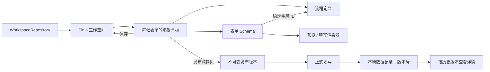

> 历史原型说明：以下内容保留旧实现的设计记录，不代表当前可用入口。当前架构见 [architecture.md](../architecture.md)。

# 平台工程与前端架构

## 技术栈与边界

Vue 3 + TypeScript + Vite，Vue Router 负责页面导航，Pinia 负责工作空间与编辑草稿，Vue Flow 负责流程图交互。表单采用自有 JSON Schema、字段注册表和递归渲染器，便于控制子表单、标签容器与流程字段权限之间的关系。表单拖拽使用原生 Drag and Drop，并提供点击添加与上下移动按钮。

原工作台 Repository 继续使用 localStorage，包含可维护的部门、员工和角色目录。新增团队协作入口通过 platformApi Repository 接入 backend/ 中的 NestJS + PostgreSQL，提供独立开发账号认证、定义发布、记录、子字段权限和任务模型验证。共享类型位于 packages/contracts，服务端具有独立运行时校验。远程组织同步、外部审批集成、附件存储、OCR、地图定位、AI、通知和插件调用仍未接通。

## 模块边界

```text
frontend/src/
  App.vue                      # 路由出口、全局提示；不承载编辑器业务
  router/                      # 按页面懒加载
  domain/
    form.ts                    # 字段类型/注册表、Schema、递归操作、校验、公式
    workflow.ts                # 流程图类型、连接校验、序列化、路径计算
    workspace.ts               # 应用、表单、发布版本、实例、示例工作空间
    organization.ts            # 组织实体、层级/范围解析、角色成员、权限与校验
    fieldConfig.ts             # 动态选项、过滤器、关联映射与组织配置的解析
    relations.ts               # 选项/记录查询、回填、级联、作用域与值显示
    fieldValidation.ts         # 发布配置检查与运行态动态值校验
    extensions.ts              # 推送/插件契约、绑定校验、本地执行与日志快照
    relationDemo.ts            # 显式安装的客户/订单示例
  repositories/
    workspaceRepository.ts     # 存储接口、格式校验、本地实现
    platformApi.ts             # 协作服务 HTTP Repository 与错误边界
  stores/
    workspace.ts               # 统一工作空间、编辑草稿、保存/发布/提交动作
    organizationActions.ts     # 组织增改、批量操作、归档恢复、写失败回滚
    platformSession.ts         # 真实服务端会话；独立于原型成员切换
  composables/
    useEditorHistory.ts        # 表单历史快照
    useDraftDismiss.ts         # 配置弹窗的未保存修改保护
    useWorkflow.ts             # 图编辑命令、选择、历史和存储回调
  features/
    workspace/                 # 首页、表单列表、分组与回收站
    collaboration/             # 已接入后端的发布、记录、权限与任务入口
    forms/                     # 表单设计、发布、填写、数据管理
      useFormDesigner.ts       # 选择、拖拽、移动、复制、字段回收站
      components/
        FieldCanvas.vue        # 设计态递归容器
        FieldInspector.vue     # 字段属性
        ChoiceFieldInspector.vue # 静态/动态选项、排序、默认值
        OrganizationFieldInspector.vue # 人员/部门范围与默认值
        RelationFieldInspector.vue # 关联源、列、过滤、回填和反向字段
        DataFilterEditor.vue   # 选择字段与关联字段共用过滤编辑器
        RelationControl.vue    # 记录选择、关联表格、嵌套详情
        FormSettingsInspector.vue # 布局、显示规则、填写缓存
        FieldControl.vue       # 30 类字段的基础控件渲染
        FormFields.vue         # 运行态容器、子表单行、标签页
        FormRuntime.vue        # 值、校验、草稿、提交
        FormPreview.vue        # 桌面/手机预览
    workflow/                  # 流程画布、工具栏、模拟器
    extensions/                # 独立懒加载的推送、插件配置与执行记录
      components/              # 分步编辑器、通用输入绑定、样本与执行轨迹
    organization/              # 独立懒加载的员工、角色、授权和权限查询页
  components/organization/     # 部门树、通用身份选择器与输入控件
  components/shared/           # 工作台和设计器导航
```

`domain` 不依赖 Vue 运行时、Pinia、DOM 或浏览器存储。流程图引用 Vue Flow 的类型；可执行图算法不加载其 UI 模块。流程编辑器按路由加载，首页不加载 Vue Flow。

## 数据流与版本



- 应用、表单、字段、选项、节点和记录各有独立 ID。字段改名不会改变 ID，因此流程权限与历史数据仍能对应。
- `openForm()` 创建独立编辑草稿；表单与流程切换共享同一草稿。切换页面不会丢弃未保存设计，刷新前提醒未保存修改。
- `saveForm()` 同步字段清单与节点权限，并提交完整草稿。存储失败保留可继续编辑的草稿，已保存设计回滚。
- `publishForm()` 将表单、流程、扩展配置和标题整体深拷贝成新版本。修改设计不会修改已发布定义，历史记录保留提交时的版本号。
- `FormRuntime` 只负责收集值和运行表单规则，持久化通过 `persistValues` 回调返回成功与否，避免显示虚假的提交成功。
- 已保存的填写草稿可在数据管理中继续填写；启用前台缓存时，同一标签页刷新也可恢复填写内容。
- `syncFormWorkflow()` 用字段 ID 更新节点权限；删除字段时移除其权限。兼容旧原型使用字段标题作为键的格式。
- 工作空间原始数据损坏时进入只读示例回退，不覆盖原始存储。当前没有内置损坏数据修复界面，可从浏览器存储备份后处理。
- 缺少组织数据的旧工作空间补入初始组织，不替换已有表单或记录。组织写入失败回滚内存副本；字段高级配置通过明确的解析函数补默认值，保持旧 Schema 可导入。

## 表单编辑与运行态

设计态和填写态共享 `FormField` 定义，但不共享选择状态。选中字段、当前标签和画布位置不进入业务 Schema。

标签页的子字段使用同一值空间；子表单每行使用独立值空间。公式按依赖计算，子表单逐行处理，循环引用返回空值。公式只接受数值、字段引用和算术运算，不执行 JavaScript。富文本渲染通过 DOMPurify 清理。

显隐规则、必填、数值范围、邮箱、手机号、唯一值校验和提交值清理在 `domain/form.ts`。错误携带完整字段路径，能够定位子表单的具体行。不可见字段可保留或清空。选择项保存 ID，显示时映射标签。

编辑历史使用最多 80 个快照，连续属性输入合并，结构操作立即形成检查点。每次打开编辑器有独立历史。字段回收站在当前编辑会话内有效；整张表单的回收站持久化保存。最多 300 个字段、四层嵌套；子表单内不再次嵌套容器。

## 组织、选项与关联

部门、员工、角色组和角色使用稳定 ID。角色可以绑定明确的成员和部门，解析时按是否包含子部门实时计算在职成员。表单、流程和后台编辑统一使用 `IdentityInput` / `OrganizationPicker`，范围规则在领域层计算，UI 不维护另一个静态人员数组。默认值同样服从可选范围；依赖部门字段变化时移除不再符合范围的成员。

`ChoiceSource` 描述手动选项或表单记录来源，包含显示字段、存储字段、过滤、排序与去重。`ReferenceConfig` 描述关联记录的过滤、展示列、字段映射和反向关系。过滤器支持常量、本表字段、当前成员或主部门作为条件值。源记录排除草稿与归档表单，修改源数据后重新求值。

`applyFieldChange` 统一处理回填和级联清理，避免页面各自实现规则。标签容器使用外层值空间，子表单逐行处理；上层条件变化时也重新校验行内依赖。复制容器时重映射本地依赖及回填目标 ID。发布前检查缺失引用和循环依赖，提交时重新检查动态选项、组织范围和关联记录，避免继续填写旧草稿时提交失效值。

反向关联是根据当前记录 ID 查询出来的派生结果，不要求用户填写，也不存储一份反向数组。关联详情按记录提交版本渲染；发布定义深拷贝隔离，但动态数据源仍读取当前本地记录，不提供历史数据源快照。角色授权和权限合并查询用于前端配置预览，不形成安全访问控制边界。

## 扩展字段

1. 在 `FieldType` / `fieldRegistry` 注册名称、分类、图标和容器能力。
2. 在 `createField()` 添加合理默认配置，并在 `parseSchema()` 明确导入校验。
3. 在 `FieldControl.vue` 添加填写控件；容器类字段同时扩展 `FieldCanvas` 与 `FormFields`。
4. 在 `FieldInspector.vue` 添加配置 UI，必要时扩展 `validateValues` 与 `prepareSubmission`。
5. 添加覆盖数据往返、嵌套值和校验语义的测试。不要在页面中维护另一套字段类型或临时索引。

## 后端接入与后续迁移

新增 `platformApi` Repository 已负责服务端调用，`platformSession` 保持真实会话。既有 WorkspaceRepository 暂不整体替换；本轮保留原工作台已有数据，并通过明确选择发布表单定义进入协作空间。后续逐项迁移应用、组织、关系和流程，避免整包覆盖多用户数据。后端事务、版本、授权和锁顺序见 backend-contracts.md。

服务端必须重新验证 Schema、权限、版本和提交值，负责唯一值约束、组织人员解析、会签/顺序审批、超时、审计、通知、附件和插件。当前 `advanceEntry` 演示单路径审批、条件选择和节点顺序；插件通过执行回调解析输入并回填，成功后再判断下游条件，失败停在当前节点。金额计算和文本组合在本地实际执行；HTTP、消息、抄送和子流程使用明确标记的本地模拟。多人并发编辑、跨设备数据和真实账号权限不由 localStorage 实现。

当前 JSON 导入/导出为设计配置；文件字段保存元数据，小图片可保存预览，不是持久附件服务。关联字段从当前本地工作台其他表单记录取值。

## 检查入口

- `npm test`：前端业务测试及真实 PostgreSQL 后端集成测试；数据库须已启动，测试使用独立 schema。
- `npm run build`：严格 TypeScript 检查与生产打包。
- `npm run test:sites`：4 项静态资源打包与路由检查。
- `design-qa.md`：浏览器完整路径、同尺寸视觉对照、窄屏检查和未验证边界。

## 扩展配置与执行

`FormExtensions` 保存事件推送，`PluginInvocation` 保存节点使用哪个动作及其输入/输出绑定。`pluginRegistry` 定义动作名称、参数类型、返回值和本地/模拟模式；页面不自己判断数值类型或拼装执行结果。`ValueBinding` 支持常量、稳定字段 ID 和文本模板，不执行 JavaScript。输出映射只允许兼容且可写入的字段。

`runWebhook` / `runPlugin` 是独立于 UI 的执行边界，接收配置、Schema 和值，返回结果及快照，不直接修改原记录。当前外部执行只返回模拟响应，不调用网络。`advanceEntry` 接收插件执行回调，原子应用成功结果，再按最新值选择下一条边；这也使后续接入服务端执行器时无需改写配置 UI。

Store 在正式提交时发出 `data_create`，审批或重试处理时发出 `data_update`。两者读取记录对应的发布版本，设计草稿不修改历史版本。数据管理编辑、软删除和恢复分别触发 data_update、data_remove、data_recover；草稿回收不产生业务推送。

执行记录保存当时的配置、Schema、输入值、输出值、回填值及失败位置，保留最近 200 条。日志重试使用旧快照生成新的试运行记录，不推进正式记录；详情中的“重试当前插件”则沿用该记录的发布版本继续执行。成员范围仍按当前组织状态解析，历史日志不是外部系统可重放事务。保存失败时回滚记录及日志。

推送与插件使用同一个字段类型检查逻辑，筛选和人员输入复用既有组件。删除字段前展示本表推送、插件、流程条件和显隐规则影响；不声称覆盖所有跨表依赖。未保存的配置关闭时可以继续编辑或放弃；保存后刷新可恢复。


## Webhook Secret 与提交结果

`domain/webhookSecurity.ts` 负责演示 Secret 的随机生成、请求构造和签名验算。为兼容官方文档，计算 UTF-8 `SHA1(nonce + ":" + rawBody + ":" + secret + ":" + timestamp)`，将签名写入 `X-JDY-Signature`，nonce/timestamp 放入 query。签名输入保留原始请求体；不会先反序列化再重建 JSON。该模块用于本地连接测试，不是生产接收端（没有时效/重放防护服务）。参考：[官方协议](https://hc.jiandaoyun.com/open/11507)。

`WorkspaceData.webhookCredentials` 独立保存带 `demo_` 前缀的演示密钥；表单配置和运行日志只记录 `credentialRef`。生成时立即持久化，失败回滚；重新生成创建新引用，旧发布版本保持原引用。取消配置后可能保留未使用的演示凭证，不自动删除历史密钥。工作空间整包导出包含这些演示凭证，不应导入生产密钥。旧的 `demo-signature` 占位项必须由用户在配置内重新生成；不静默修改已发布版本。

`checkWebhookConnection` 本地构造带签名的请求并核验，支持正确密钥、错误密钥和超时场景，不调用 fetch。`runWebhook` 的事件推送仍是同步模拟，不宣称网络连接成功。生产接入时应将密钥存储、签名发送、接收验签与连接测试迁移到服务端边界，前端仅保存凭证引用。

提交提示保存在共享的 `FormSchema.settings`，使用 `successMessage`、`successMode`、`allowAnotherSubmission`。旧 Schema 默认表单下方提示并允许继续填写。扩展配置预览与 `FormRuntime` 共用 `SubmissionReceipt`；只有持久化成功才进入提交结果状态，阻止同一状态重复提交；继续填写按默认值重置。配置随发布快照生效，不回写历史版本。


## 记录展示与打印

`domain/presentation.ts` 定义 `DetailSettings`、`PrintTemplate` 和只读 `RecordBlock`。表单扩展保存 `detail` 与 `printTemplates`，解析器兼容没有这两项的旧存储；发布时整体深拷贝。配置字段由稳定 ID 指定，字段删除影响提示与发布校验包含详情和未归档模板。`presentationActions` 独立处理配置保存和失败回滚。

`RecordBody` 同时服务详情、设置预览和 `PrintDocument`。字段按配置顺序读取，标签页展开而子表单保持行作用域；隐藏容器/条件字段不会打印出保留值，空值可隐藏但数值 0 保留。关联数据仍读取当前本地记录，与原有关系组件一致；详情保留关联详情入口。打印文本由 Vue 转义，只嵌入本地 PNG/JPEG/WebP data URL，不抓取外部图片。富文本在打印稿中使用纯文本。

记录详情从提交版本读取展示配置；没有配置的历史版本保持原来的只读填写器。打印入口同样取提交版本，未配置模板时提供标准布局。`printRecord` 克隆已渲染的单据到独立 iframe，仅附加单据 CSS 和限定枚举生成的 `@page` 纸张设置，再调用浏览器打印。它不截取整个管理界面、不把用户内容拼为 HTML，也不宣称打印调用成功即已保存 PDF。系统最终分页和打印输出需要宿主支持。


## 数据管理与回收站

`RecordList` 独立承载查询、列设置、排序、分页和批量选择；`domain/records.ts` 使用显示名称搜索与历史 Schema 解析，数字列按数值排序。列 ID、排序和每页条数保存在工作空间的 `recordViews`，不写入表单发布版本；查询与筛选为页面会话状态，改变筛选会清除选择，避免误操作隐藏记录。导出使用全部筛选结果或明确勾选项，不只导出当前页。

`recordActions` 管理更新和回收。编辑使用提交版本的 Schema，重新验证唯一值、格式和动态范围，保持流程节点位置；仅追加修改历史和事件。`deletedAt` 标记软删除，不删除原始值与版本信息。待办、统计、关系候选和动态选项排除回收站记录，旧引用仍保留 ID。批量恢复先对整个候选批次验证值约束/唯一性，有冲突则全部不恢复；不因当前动态数据源变化而抹掉历史记录。记录、历史及推送日志一起保存，失败一起回滚；回收站记录不能审批或重试插件。

当前记录编辑入口是本地管理操作，不是服务端角色授权边界。编辑弹窗关闭时有未保存保护；不提供永久删除。表单草稿继续填写沿用原入口。


## 推送提醒

`domain/reminders.ts` 独立定义提醒配置、引用检查、消息呈现、人员解析和纯模拟执行器。模板保存稳定字段 ID，列表显示字段名，消息执行时使用共享 `displayValue` 转成人员姓名、选项名称和关联记录标题。子表单只显示行数，不跨越行作用域读取子字段。配置被纳入 `parseExtensions`、删除字段影响检查与发布校验；复制表单会生成新的提醒 ID 并停用。

事件提醒加入已有 `emitDataEvent`，使用该记录所属发布版本。日期提醒在 `reminderActions.checkDueReminders` 中扫描非草稿、未回收记录，按历史版本、字段日期、相对天数和当前浏览器时区计算。日期字段原有时分由配置时间替代。没有后台轮询；页面提供显式检查按钮。日期值缺失/非法会被统计，条件不满足保留后续资格。

成功日期提醒在记录的 `reminderReceipts` 保存版本/提醒 ID/到期时间标记。标记独立于最多 200 条的执行日志，因此日志被裁剪或刷新不会重复；日期修改形成新的触发项，改回已触发日期仍会去重。持久化失败时标记与日志一起回滚。旧记录保留原发布规则，草稿停用或归档须发布后影响新记录。接收人根据当前组织状态解析，排除停用、离职以及归档范围。

提醒使用通用 `ExtensionRun` 的 `kind=reminder`、`origin=record/schedule/trial`。日期试运行的检查时间存为输入 `checkedAt`，日志 `time` 始终为实际运行时间；日志重试使用配置与记录快照及原检查时间，不写真实记录触发标记。组织与关联显示名称依然来自当前本地数据。所有通道明确模拟，没有真实发送适配器。

`docs/responsive-preview.html` 是开发验收辅助页，在同源 iframe 中提供 390/750/1280px 尺寸；不随生产入口打包，不属于产品功能。

## 自定义按钮

`domain/buttons.ts` 定义可序列化配置、引用与发布检查以及纯准备函数 `prepareButton`。配置包含位置、显隐条件、动作、参数/字段绑定和确认提示，沿用共享稳定字段 ID；`FormExtensions.buttons` 为可选字段，旧工作空间不强制迁移。复制表单重新生成按钮 ID 并停用，发布版本保留不可变配置。

准备阶段只计算 URL 或下一份表单值，不写记录、不打开浏览器。所有来源从同一数据快照解析，字段赋值复用联动清理与计算逻辑；检查直接映射是否被依赖范围清除，并拒绝静态/条件隐藏或只读的目标。必填项可留给目标填写页补全，保存已有记录时由 `recordActions` 完整校验。

`ButtonEditor` 和运行入口共享准备函数。`CustomButtonBar` 在填写页、详情和行内显示同一套动作，确认前重新计算结果；如果条件、目标版本或变更内容已变化，展示新结果并要求重新检查。填写页发出 apply 事件；记录更新复用 `updateEntry`，额外记录按钮名称并触发表单数据事件；打开表单通过 `buttonActions` 的一次性内存预填队列携带字段值，不把业务数据塞进地址。目标 URL 只带随机标记，绑定目标版本，不自动提交。

配置读取、保存、归档恢复和运行层彼此分离。试运行仅展示准备结果，不创建业务记录；实际记录动作使用既有记录历史与推送日志。具体证据和当前值类型边界见 [自定义按钮验收](buttons-qa.md)。

## 数据标题与表格快捷编辑

`domain/collaboration.ts` 定义可选的 `FormExtensions.collaboration`、标题片段及编辑准备函数，旧工作空间保持兼容。标题由固定文字和稳定字段 ID 拼接，使用共享值显示及条件可见性逻辑，不跨子表行取值。`entryTitle` 按记录版本读取配置，供列表、详情、工作台、搜索和导出复用；不以最新草稿替换历史定义。`presentationActions.saveCollaboration` 负责保存和失败回滚，配置引用进入字段删除提示与发布校验。

`prepareInlineEdit` 是纯函数，先检查历史配置和当前字段/父容器可见及可编辑状态，再复用 `applyFieldChange`、计算、提交清理、唯一值及动态范围校验，返回完整新值和变更列表。`recordActions.updateEntryField` 比对编辑初始值快照后，调用既有 `updateEntry` 原子保存值、历史和事件；无变化不重复追加历史。字段快照用于实例内的编辑冲突判断；公共持久化动作现在共用文末所述的同源写入锁。

`InlineRecordEditor` 仅管理单元格编辑值、变更预览、焦点和退出保护，使用原 `FieldControl` 渲染。`RecordList` 同时只开放一个编辑器，避免筛选/分页或其他动作使未保存行消失。同路由参数变化与离开当前路由都经过确认，路由失败不更新文档标题；共享弹窗的关闭完成事件用于恢复编辑焦点。成员权限组由独立发布模块提供，当前管理入口仍不能代替服务端权限检查。

## 成员发布与访问策略

`domain/access.ts` 管理权限组解析、在职身份解析、逐记录范围判定、字段 Schema、填写限制和成员操作准备。`WorkspaceData.formAccess` 按表单 ID 保存即时访问策略；不会随设计草稿保存而覆盖，也不写进历史发布快照。角色/部门成员仍取共享组织目录，旧数据缺少 `createdBy`/`createdDepartmentIds` 时保留未知归属。

先求成员对记录生效的组，再判断操作和字段，避免“查看全部 + 编辑本人”合并成编辑全部。导出/打印只使用包含该操作的组所授字段；容器和子字段必须在同一组内获得完整路径授权，新字段缺省隐藏。权限筛选字段的删除进入设计器影响提示，并阻止发布失效引用。

`accessActions` 对提交、更新和删除重新检查权限；编辑比对完整初始值快照，只合并允许输入，重新计算映射/计算/提交清理，并拒绝副作用修改只读数据。子表存在只读列时禁止增删行；可编辑单元格按行更新，保留其余值。新记录按设计与发起节点权限填默认值，声明的关联映射由当前可见数据源重算，避免信任回填输入。持久化复用原记录事务及失败回滚。

`MemberPortalView` 独立懒加载。`useRuntimeData` 通过 Vue 注入为字段、关系和组织选择器提供当前身份以及经过权限筛选的关系数据；管理端默认使用完整工作空间。当前记录的可见性条件和计算在完整本地值上计算，由权限 Schema 控制渲染，避免隐藏条件来源后导致错误显隐/计算。成员编辑仅重新检查可编辑字段的动态候选，已有只读人员离职不要求成员修改无权变更的字段。

发布设置提供本地填写链接、收集开关、起止时间、上限、重复提交及成员访问。数量与重复检查排除草稿和软删除记录；提交时重查，不依赖禁用按钮。权限设置即时生效仅承诺当前应用实例及刷新后的本地存储，其他页面检测到更新后停止写入，须打开最新页面读取新权限；账号认证与服务端安全隔离仍在接入边界。


## 智能助手的顺序动作与记录事务

`domain/automation.ts` 管理可选的 `FormExtensions.automations`、动作链和 `prepareAutomation`。配置中的目标表单 ID 与发布版本固定，来源使用发布 Schema 的字段 ID；目标更新按每条历史记录版本检查兼容性。目标版本不随其他表单重新发布而漂移。

字段映射提取为 `buttons.mapFieldValues`，由按钮与助手共用类型转换、动态选择、联动和差异计算；助手在此基础上追加完整目标表单校验和唯一值检查。每条规则先在复制的记录集上按顺序计算，成功时返回目标记录集；失败返回空提交集。后续步骤可查询前面的暂存记录，来源绑定始终使用初始事件快照。

`automationActions.saveAutomation` 只保存草稿配置；`workspace.emitDataEvent` 读取来源版本，按触发身份运行准备函数，再合并变更、追加日志。派生记录不递归调用事件函数。目标流程复用 `advanceEntry/runPlugin`，模拟插件结果在动作轨迹里标注。失败不会阻止来源操作，但提供通知和配置快照日志。

`recordTransaction.recordCheckpoint` 为来源操作建立共同回滚边界，保留既有记录对象引用；保存失败时恢复整个记录集及执行日志，避免跨表写入一半。提交、普通/成员编辑、回收恢复、审批与插件重试共用这个边界。值没有变化的审批流转不触发数据更新助手。此边界覆盖当前实例和单次本地存储写入，不提供服务端或跨标签页事务。

`AutomationSettings/AutomationEditor/AutomationStepEditor` 分离列表、向导和单步配置；复用 `DataFilterEditor`、`FieldControl`、`SampleEditor` 和 `RunTrace`。测试日志只保留试算结果，“重试”也只试算，不自动补发或重复创建记录。字段删除影响提示仅涉及来源配置；目标引用固定在不可变历史 Schema，不随目标草稿删字段而失效。

## 在线支付与本地订单

`domain/payments.ts` 定义支付配置、演示商户、报价、订单、状态转换所需的校验与解析函数。金额统一使用整数分，拒绝负数、超过范围和真实三位小数；金额与说明绑定只读取根级或标签页中的标量字段，不跨越子表行作用域。条件过滤复用共享数据筛选。配置进入不可变发布快照，报价必须取得记录的精确历史版本，不静默套用最新草稿。

`WorkspaceData.paymentMerchants/paymentOrders` 与表单 Schema 分开存储，旧数据缺省为空。订单保留原始金额、商户名称、付款人、版本、有效期、支付尝试与退款历史。失败后有效订单可以重试；取消、过期、付款人或报价变化后重新创建，并原子关闭旧订单。已结算订单保持原金额，重复回调不产生第二次支付或历史记录。

`paymentActions` 负责保存配置、商户、发起/完成/取消和退款。付款完成时重新检查记录、金额、条件和商户，防止提交前状态变化。成员操作明确传入 actorId 与权限组选择，校验本人记录及查看/提交权限；后台仍是本地演示管理入口。订单和记录历史统一经 `recordCheckpoint` 回滚，只有持久化成功才反馈成功。

`PaymentSettings`、`MerchantEditor`、`RecordPayment`、`PaymentCheckout` 分别负责配置、商户、记录入口与收银台。填写结果、管理员详情和成员详情共享入口组件；`PaymentsView` 是独立懒加载后台页。所有支付方式只驱动本地状态，无真实 SDK、二维码、支付账户或网络请求。结果映射保存稳定目标字段 ID，`domain/paymentResults.ts` 完成类型转换、关联依赖更新、计算和校验；系统输出可写成员只读字段，隐藏目标也执行长度/唯一值等校验。回填只发生在成功支付、零元确认或退款，待支付/失败/取消不填充结算结果。配置不能覆盖金额或说明的直接来源字段。


`domain/events.ts` 提供数据事件与支付事件目录，Webhook 和提醒仍只消费数据事件；智能助手允许 `payment_paid/payment_free/payment_refunded`。支付事务先回填、再以回填后的来源快照准备助手动作，最后一次持久化订单、来源、派生记录和日志。已结算订单的重复成功回调直接返回；退款只在累计退款增加时触发。助手业务校验失败保留支付成功并记录失败日志，持久化失败撤回全部变更。派生写入不递归发事件，支付回填也不额外派发 `data_update`，避免同一次操作重复执行规则。成员身份沿调用参数传入回填校验及自动化上下文；重试日志仍只试算。

## 快捷填报的解析、检查与回填

`FormExtensions.quickFill` 保存稳定字段 ID、输入方式、别名、说明和示例。`domain/quickFill.ts` 管理配置迁移、有效目标、流程发起权限、候选值解析、图片限制和 `prepareQuickFill`。字符串标签先转换为稳定选项/身份/记录 ID，依赖按多轮求值处理，不能确定唯一候选时返回错误。运行时条件同时检查父标签页；关联映射不能越过隐藏、只读或容器写入边界。

`services/quickFillExtractor.ts` 定义可替换的提取接口，当前 `localQuickFillExtractor` 只在内存解析标签行和 JSON，并返回原文依据与未匹配内容。接口接受取消信号；实现没有模型、OCR 或网络调用。字段说明保存为配置，由结果检查页展示；本地规则不解释自然语言指令。

`QuickFillSettings` 使用独立草稿及取消保护，通过 `quickFillActions.saveQuickFill` 规范化、验证并保存；失败恢复原配置。启用配置在发布时重新验证，复制表单保留字段配置但关闭功能。`QuickFillDialog` 由配置预览、正式填写和成员新增共用，结果编辑复用 `FieldControl` 与注入的 `useRuntimeData`，避免绕过成员可见的候选记录。

`prepareQuickFill` 只构造新值和差异，不持久化。应用共享关联/计算规则后恢复不可写目标并重新计算，检查所选结果是否仍与范围和显隐规则兼容。局部填报不要求未选择字段已完成，但所选必填字段不能置空；完整提交仍执行既有校验。确认时比较当前配置、表单和重算差异，变化后要求重新检查。覆盖或间接变化必须显式确认，最终 emit 到 FormRuntime；不会调用提交、支付或自动化。

图片只按本地附件约定保留元数据和小图 data URL，拒绝不支持类型、过大文件和外部预览 URL。输入源和提取结果不写入执行日志或独立缓存；用户确认后的值才进入现有表单缓存/提交路径。保存层已补旧快照比较与恢复副本，具体边界见下节；公共持久化操作另由文末所述的同源写入锁保护，仍不提供实时协作或自动合并。


## 旧快照检查与设计恢复

`LocalWorkspaceRepository` 在成功加载后保留原始序列化快照，保存前与当前存储逐字比较。没有成功加载、最新数据变化、被清除或损坏时都不能静默覆盖；写入失败不推进基线。最近访问使用独立的 `workflow-studio-recent-forms-v1` 缓存，读取或更新失败不影响业务保存，打开页面不再重写整份工作空间。

`stores/workspacePersistence.ts` 统一处理存储错误、冲突提示和恢复状态。`persist` 失败时在业务回滚之前捕获最近一次尝试，放在独立内存引用中，不能被当作已提交数据。备份明确区分原基线、当前工作副本、设计草稿、最后尝试和最新原始数据；没有触发保存的组件内输入可能不在备份中，界面保持原页面供对照。

`WorkspaceRecovery` 监听 storage、页面获得焦点和恢复可见，提示后不会替换旧 store 的对象。新页面加载最新数据；另存设计使用单独的 Repository 读取新基线并再次检查，只追加新的未发布表单。`domain/formCopy.ts` 复用正常复制的规则，去除发布历史、关闭自动扩展并生成配置 ID；不会合并记录、支付、组织或权限。同一设计重复另存会复用已创建的副本；原应用已移除、数据损坏、表单数达到上限或另存期间有新更新则停止。

旧快照比较现处于共享 Web Lock 内，业务操作及恢复共用该锁，详见下节。旧页面仍不自动重载或合并草稿。

## 共享头像菜单

`components/shared/UserMenu.vue` 供工作台头部、表单列表和设计器共用。个人信息只修改姓名、邮箱和电话，复用组织校验与保存事务；身份切换复用范围成员选择器和 `setCurrentUser`。部门、工号、状态和角色不通过个人信息修改。菜单支持键盘、空白关闭和焦点返回，资料/身份弹窗复用未保存保护，保存错误在弹窗内显示。工作空间备份打开全局恢复组件；没有把本地身份切换呈现为真实登录。

## 同源页面写入保护

`repositories/workspaceWriteLock.ts` 使用固定锁名 `workflow-studio-workspace-write-v1`。`workspaceWrites` 把公共持久化动作统一转换为 Promise，进入锁之前复制参数；内部 action、嵌套 action、领域计算、快照比较、一次写入及既有失败回滚保持同步。不把 `persist()` 单独改成异步，避免调用方在真正写入前误判成功或提前结束回滚。类型约束禁止将异步 action 放进同步事务核心。

同页重复点击由 `writePending` 拦截；跨页使用 `ifAvailable`，忙时立即报告未执行，要求用户稍后重试，不在后台排队应用可能已取消的输入。第二次操作获得锁后仍须通过旧快照比较。恢复读取最新基线、复制设计并保存也在同一锁内，仓库拒绝绕过锁的直接写入。没有 Web Locks 或请求被拒绝时不回退为无锁写入，保留当前输入与导出入口。API 的作用域与生命周期依据 [MDN Web Locks API](https://developer.mozilla.org/en-US/docs/Web/API/Web_Locks_API) 和 [request 选项](https://developer.mozilla.org/en-US/docs/Web/API/LockManager/request)。

页面在 await 后决定跳转、关闭弹窗或显示成功；填写运行时有提交中状态与独立失败样式，流程启用在异步保存期间不会被自动撤销。BaseDialog 在保存期间阻止退出和二次操作。App 给全局冲突提示分配独立布局空间，避免遮挡填写按钮；提示可滚动，编辑器继续占剩余高度。

保障范围是使用同一锁协议的同源当前版本页面。旧版本页面、直接改动 localStorage 的脚本、浏览器清理以及不同设备不遵循此锁，不能声称受该协议完整保护。组件草稿登记已分批接入，完整覆盖、无损合并和实时多人协作仍未实现。


## 组件内输入的编辑暂存

`useEditorDraft` 通过稳定来源键、开始编辑时的上下文快照与恢复适配器登记组件内输入。`editorDrafts` store 捕获脏值到内存，并在输入停止 350ms 后由 `EditorDraftRepository` 自动写入标签页 sessionStorage；卸载和刷新前同步保留最后输入。正式填写通过 `autoPersist` 遵循表单的 `cacheDraft` 设置，关闭时不自动持久化。存储失败保留输入并保护退出，不修改业务工作空间或覆盖损坏的原暂存。导入统一进行大小、元数据、JSON 属性和目标适配器检查。恢复前后比较确认票据中的草稿和当前输入，防止确认期间内容变化；仅将输入放回匹配的活跃编辑器，不重放业务命令。

当前接入个人信息、WebhookEditor、PluginEditor、AutomationEditor、正式 FormRuntime；BaseDialog 与填写页显示共用恢复入口。成员键加入填写缓存，防止体验身份共用同一份缓存。表单字段 Schema、原配置/记录或当前成员不匹配时保持副本供人工对照。保存/放弃清理当前编辑会话的快照，其他保留或导入快照由用户整理。完整工作副本增加 editorDrafts，仍保留旧的工作空间/设计草稿/失败尝试数据。细节与限制见 [编辑暂存验收](editor-drafts-qa.md)。

`EditorDraftNotice` 只展示同一来源、非当前编辑会话的草稿，在原编辑器内确认恢复，不打开工作空间维护工具。恢复时沿用被恢复草稿的 ID，后续保存或放弃能清理它，避免反复提示。暂不恢复仅隐藏本次提示。当前输入不显示恢复横幅；暂存失败按来源键显示重试提示。`FormRuntime` 暴露清理、刷新前保留及保留状态，记录管理和成员弹窗的显式放弃会清理草稿。带恢复入口的 BaseDialog 使用固定头尾和可滚动正文，窄屏仍可操作底部按钮。


插件与智能助手通过 `extensionDraftAdapters.ts` 检查结构并保留未完成配置、稳定字段 ID、固定目标版本与动作顺序。恢复不会带回试运行结果或执行动作，原配置/Schema/成员改变仍由共享上下文检查拒绝恢复。插件重新选择同一动作保留参数，切换为不同动作前确认参数重置。

`PluginEditor.saveConfig` 明确返回同步或异步保存结果：扩展页等待 Repository 保存成功，流程页只确认应用到流程草稿，仍需保存流程。失败或抛错时编辑器保留输入和暂存，成功才清理并关闭。`AutomationEditor` 同样等待保存确认；两者将局部 saving 交给 BaseDialog，与工作空间 writePending 一起限制关闭和重复操作。恢复适配不等于执行集成，外部连接继续模拟。

## 通用弹窗生命周期

填写业务补充：`domain/fillingSession.ts` 决定填写草稿身份、所属成员和原发布版本。页面固定初始定义及输入，命令执行时重新检查记录；成功保存后才更新可恢复的草稿 URL。成员切换重新限制访问，不因自身提交改变记录状态而在保存中卸载填写器。原记录的 createdAt 保持稳定，各次保存/提交追加操作记录。

`FormRuntime` 不再同时写旧的单表缓存和共用编辑暂存。`legacyFillCache` 只在校验并持久保留恢复副本后移除旧数据，不直接填入表单；未成功迁移保留原文。编辑上下文使用对象键排序后的指纹比较，兼容读取归一化的属性顺序变化，数组顺序及业务值变化仍不兼容。详见 [填写草稿验收](filling-drafts-qa.md)。

BaseDialog 的 open 属性直接控制 DOM 挂载和移除，不再调用原生 showModal/close 维护另一份可见状态。FormPreview 同样使用 useDialogLayer；dialogStack 只管理层级、Esc/Tab、inert、焦点归还和滚动恢复。关闭方式统一请求业务回调，保留未保存确认。最后一个弹框释放时恢复页面原始状态；父窗口先卸载也能正确清理。

ReminderEditor 和 ButtonEditor 已接入恢复适配与明确保存回执，失败保留输入，成功才清理并关闭；恢复后重置步骤、样例和试运行结果。详细边界见 [通用弹窗验收](dialog-close-qa.md)。

## 记录文件交付

`recordPdf.ts` 复用展示领域模型，将当前记录的原版本 Schema、模板及运行范围数据转为 PDF 文档定义；字段显隐、子表和关联内容与记录预览共用解析。宽表按纸张可读宽度分组，保留全部列并重复行号和首列。表标题和列头随页重复，正文可分页。A4/A5、方向、字体大小、单双列及历史/元信息开关源自所选模板。

`exportRecordPdf.ts` 延迟导入 pdfmake 0.3，首次从本站加载 OFL 中文字体并缓存；仅处理本地 PNG/JPEG/WebP 预览，经解码转成 PDF 支持的 PNG。业务数据不经过远程字体或文件服务。生成失败交由界面显示与重试，成功生成 Blob 后发起下载并提供再次下载链接。`RecordPrintDialog` 用操作序号忽略关闭、切换模板或记录后的旧结果，避免异步完成后误下载。

保留原生打印适配器，直接 PDF 下载用于明确的文件交付。系统打印宿主仍有未验证边界，见 [PDF 验收](pdf-delivery-qa.md)。客户端用法依据 [pdfmake 官方文档](https://pdfmake.github.io/docs/0.3/getting-started/client-side/methods/)，最终依据应用实际导出文件验证。
